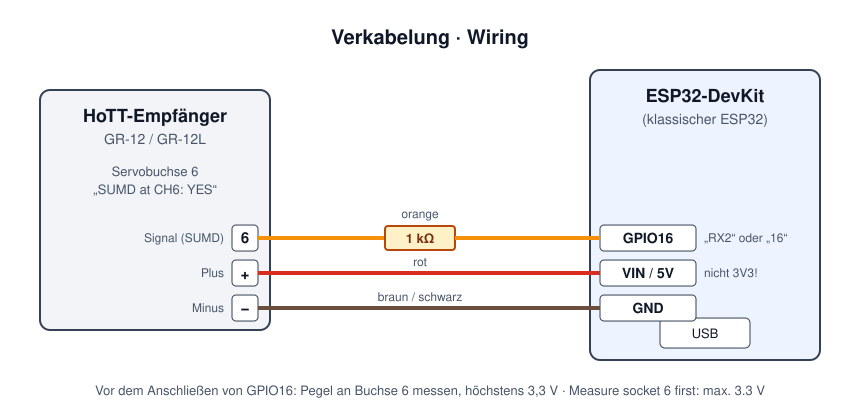

# awsmSIM Receiver Control

[Deutsch](README.md) · **English**

This project lets you fly [awsmSIM](https://awsmsim.app) wirelessly over Bluetooth with your own Graupner HoTT transmitter, for example an **mz-18**.

A HoTT receiver passes the sticks to an ESP32 as a digital sum signal (SUMD). The ESP32 shows up on your phone, tablet or computer as a plain **Bluetooth gamepad**, and awsmSIM reads it in the browser.

```
mz-18  ──HoTT 2.4 GHz──▶  GR-12  ──SUMD──▶  ESP32  ──Bluetooth──▶  browser (awsmSIM)
```

Building it and the firmware are free and open (MIT licence). Flying with a transmitter in awsmSIM is part of **Pilot Plus**.

---

## Contents

1. [What you need](#1-what-you-need)
2. [Switch the receiver to SUMD](#2-switch-the-receiver-to-sumd)
3. [Wiring](#3-wiring)
4. [Flash the firmware](#4-flash-the-firmware)
5. [Check with the stick monitor](#5-check-with-the-stick-monitor)
6. [Pair over Bluetooth](#6-pair-over-bluetooth)
7. [Calibrate in awsmSIM](#7-calibrate-in-awsmsim)
8. [Troubleshooting](#8-troubleshooting)
9. [Technical details](#9-technical-details)

---

## 1. What you need

| Part | Note |
|---|---|
| Graupner HoTT transmitter | tested with the mz-18 |
| HoTT receiver with SUMD | GR-12 or GR-12L (SUMD comes out of servo socket 6) |
| ESP32 DevKit (classic ESP32) | e.g. "ESP32 DEVKIT V1" (30 pins) or "ESP32-DevKitC" (38 pins) |
| 1 kΩ resistor | colour bands brown-black-red |
| 3 female–female jumper wires or a servo extension lead | |
| USB cable with data lines | charge-only cables do not work |
| USB power supply or power bank | powers the ESP32 **and** the receiver |
| Multimeter | to measure the signal level once |

**Works on:** Android (Chrome), Windows, macOS and Linux (Chrome, Edge, Firefox).
**Does not work on iPhone and iPad:** Safari only shows gamepads from certain manufacturers there.

## 2. Switch the receiver to SUMD

Out of the box, socket 6 is a normal servo output. To switch it to SUMD:

1. **Bind** the receiver to the transmitter and power it. The receiver pages only appear on the transmitter while the receiver is running.
2. On the transmitter, open the **telemetry menu** and page through the **receiver settings**.
3. Set **"SUMD at CH6"** to **YES**.
4. Power-cycle the receiver.

If the line is missing, the receiver probably has older firmware. You can update it with Graupner's firmware tool.

> **Tip:** Create a **separate model memory** for the simulator. You can then change anything there without touching a real model.

## 3. Wiring



| Receiver, socket 6 | Wire | ESP32 |
|---|---|---|
| **6** (signal) | orange | through **1 kΩ** to **GPIO16** |
| **+** | red | **VIN** or **5V** (not 3V3) |
| **−** | brown/black | **GND** |

**Where is GPIO16?** Hold the board with the USB connector at the bottom:

- **30-pin (DEVKIT V1):** labelled **"RX2"**, right side, 10th pin from the top (just below "TX2"). VIN is bottom left, next to the USB connector.
- **38-pin (DevKitC):** labelled **"16"**, right side, 12th pin from the top (below "17"). 5V is bottom left.
- Do **not** use "RX0" or "RX"; that is the USB serial port.

**Measure first:** Connect plus and minus, power the ESP32 via USB, switch the transmitter on. Then measure between **6** and **−**:

- With SUMD switched on, **about 2.5 to 3.3 V** is correct. Only then connect the signal to GPIO16 through the resistor.
- If the meter shows about **0.2 V**, SUMD is still off (socket 6 is still sending servo pulses). Go back to step 2.
- If it reads **well above 3.3 V**, do **not** connect the signal; you will need a voltage divider.

Power can enter the receiver through any socket, because + and − are connected internally. If an ESC with BEC and battery is still plugged into the receiver, **leave the ESP32's red wire off**, otherwise two power sources feed against each other.

## 4. Flash the firmware

You need [PlatformIO](https://platformio.org), either as a VS Code extension or on the command line (`pip install platformio`).

```bash
git clone https://github.com/shoxious/awsmsim-receiver-control.git
cd awsmsim-receiver-control
pio run -t upload          # build and flash to the ESP32
```

In VS Code: open the folder, plug in the ESP32 via USB, and click **→ Upload** at the bottom.

## 5. Check with the stick monitor

The firmware reports the channels over USB every 100 ms. The stick monitor shows them as bars and highlights the channel you are moving:

```bash
pip install pyserial
python tools/knueppel_monitor.py        # optionally with a port, e.g. COM3 or /dev/ttyUSB0
```

```
Empfänger: SUMD ok    Bluetooth: wartet

K1 Gas        1103 µs   -78 %  ····█───────────────┼····················
K2 Quer       1501 µs    +0 %  ····················█····················
K3 Hoehe      1495 µs    -1 %  ····················█····················
K4 Seite      1501 µs    +0 %  ····················█····················
```

(The monitor labels are in German: Gas = throttle, Quer = aileron, Hoehe = elevator, Seite = rudder.)

Without Python, `pio device monitor` (115200 baud) works too. If it says **"SUMD ok"** and the values follow the sticks, the wiring and the receiver are fine.

## 6. Pair over Bluetooth

The ESP32 is called **"awsmSIM Empfaenger"**.

- **Android:** *Settings → Bluetooth → Pair new device*.
- **Windows:** *Settings → Bluetooth & devices → Add device → Bluetooth*.
- **macOS:** *System Settings → Bluetooth*.

The ESP32 accepts only **one** connection at a time. If it is connected to another device, disconnect it there first.

| LED on the ESP32 | Meaning |
|---|---|
| slow blink | waiting for Bluetooth |
| solid | connected, signal from the transmitter |
| fast blink | connected, but no signal (transmitter off or failsafe) |

## 7. Calibrate in awsmSIM

1. Open [awsmsim.app](https://awsmsim.app) in **Chrome** (Android) or Chrome, Edge or Firefox (computer) and sign in.
2. **Move one stick fully to its end once.** The browser only shows the gamepad after that.
3. Open *Einstellungen → Sender-Kalibrierung* (Settings → transmitter calibration). The channels arrive in Graupner order, which is also awsmSIM's default:

   | Function | Channel | Axis |
   |---|---|---|
   | Throttle | K1 | 0 |
   | Aileron | K2 | 1 |
   | Elevator | K3 | 2 |
   | Rudder | K4 | 3 |

4. Move each stick on its own and check it. Depending on the model memory, a direction may be reversed or aileron and rudder may be swapped; fix it there (assign the axis or tick "reverse").
5. **Save.** The calibration belongs to this transmitter and is kept.

## 8. Troubleshooting

| Symptom | Cause and fix |
|---|---|
| Receiver LED stays dark | It has no power. Measure between + and − on the receiver (about 4.5–5 V). Red goes to VIN/5V, not 3V3. Jumper wires often sit loosely in servo plugs. |
| Monitor shows "SUMD kein Signal" (no signal) | SUMD is still off in the receiver (step 2), or the signal is not on GPIO16. |
| Monitor shows "FAILSAFE" | The receiver has no link to the transmitter: switch the transmitter on or rebind. |
| Bluetooth device does not appear | Restart the ESP32. It must not be connected to any other device. |
| Windows finds the device but says it cannot connect | Cross-check with a phone, e.g. with the "nRF Connect" app. If the phone connects, the problem is the computer's Bluetooth: reboot, a newer Bluetooth driver or a USB Bluetooth dongle. |
| Gamepad does not appear in the browser | After the page has loaded, move a stick fully to its end once. It does not work on iPhone and iPad. |
| Sticks swapped or reversed | Change it in awsmSIM under *Sender-Kalibrierung* (step 7). |

## 9. Technical details

- **SUMD:** 115,200 baud, 8N1, about 100 frames per second, CRC16-CCITT checksum. The decoder (`lib/sumd`) discards corrupted frames and resynchronises on the next valid one.
- **Axes** (`lib/achsen`): 988–2012 µs → 0–32767. K1–K8 → X, Y, Z, RX, RY, RZ, slider 1, slider 2.
- **Failsafe:** If the receiver reports failsafe or no frame arrives for 100 ms, the control axes go to centre and the throttle to minimum. Button 1 is pressed.
- **Bluetooth:** HID gamepad via [ESP32-BLE-Gamepad](https://github.com/lemmingDev/ESP32-BLE-Gamepad) 0.5.4 and [NimBLE-Arduino](https://github.com/h2zero/NimBLE-Arduino) 1.4.3.
- **Testing without hardware:** `python tools/host_tests.py` builds the decoder and the axis mapping for your computer and checks them. It needs a C++ compiler, e.g. `pip install ziglang`.

```
platformio.ini        board, libraries
src/main.cpp          UART, Bluetooth, LED, serial output
src/kennung.h         device name
lib/sumd/             SUMD decoder (plain C++)
lib/achsen/           channel → axis, failsafe (plain C++)
test/                 host drivers for the checks
tools/                stick monitor, host test runner
docs/                 wiring diagram
```

## Licence

MIT, see [LICENSE](LICENSE). Graupner, HoTT and mz-18 are trademarks of their respective owners. This project is not affiliated with Graupner.
