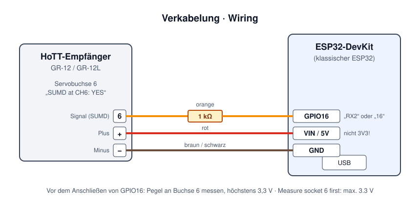

# awsmSIM Receiver Control

**Deutsch** · [English](README.en.md)

Mit diesem Projekt fliegst du [awsmSIM](https://awsmsim.app) mit deiner eigenen Graupner-HoTT-Fernsteuerung, zum Beispiel einer **mz-18**, kabellos per Bluetooth.

Ein HoTT-Empfänger gibt die Knüppel als digitales Summensignal (SUMD) an einen ESP32 weiter. Der ESP32 meldet sich beim Handy, Tablet oder Rechner als ganz normales **Bluetooth-Gamepad**, und awsmSIM liest es im Browser.

```
mz-18  ──HoTT 2,4 GHz──▶  GR-12  ──SUMD──▶  ESP32  ──Bluetooth──▶  Browser (awsmSIM)
```

Bauen und Firmware sind kostenlos und offen (MIT-Lizenz). Fliegen mit einer Fernsteuerung gehört in awsmSIM zu **Pilot Plus**.

---

## Inhalt

1. [Was du brauchst](#1-was-du-brauchst)
2. [Empfänger auf SUMD stellen](#2-empfänger-auf-sumd-stellen)
3. [Verkabeln](#3-verkabeln)
4. [Firmware aufspielen](#4-firmware-aufspielen)
5. [Prüfen mit der Knüppelanzeige](#5-prüfen-mit-der-knüppelanzeige)
6. [Bluetooth koppeln](#6-bluetooth-koppeln)
7. [In awsmSIM kalibrieren](#7-in-awsmsim-kalibrieren)
8. [Fehlersuche](#8-fehlersuche)
9. [Technik](#9-technik)

---

## 1. Was du brauchst

| Teil | Hinweis |
|---|---|
| Graupner-HoTT-Sender | erprobt mit der mz-18 |
| HoTT-Empfänger mit SUMD | GR-12 oder GR-12L (SUMD kommt aus Servobuchse 6) |
| ESP32-DevKit (klassischer ESP32) | z. B. „ESP32 DEVKIT V1“ (30 Pins) oder „ESP32-DevKitC“ (38 Pins) |
| Widerstand 1 kΩ | Farbringe braun-schwarz-rot |
| 3 Steckbrücken Buchse–Buchse oder ein Servo-Verlängerungskabel | |
| USB-Kabel mit Datenleitungen | reine Ladekabel funktionieren nicht |
| USB-Netzteil oder Powerbank | versorgt ESP32 **und** Empfänger |
| Multimeter | zum einmaligen Messen des Signalpegels |

**Läuft auf:** Android (Chrome), Windows, macOS und Linux (Chrome, Edge, Firefox).
**Läuft nicht auf iPhone und iPad:** Safari zeigt dort nur Gamepads bestimmter Hersteller an.

## 2. Empfänger auf SUMD stellen

Im Werkszustand ist Buchse 6 ein normaler Servoausgang. So schaltest du sie auf SUMD um:

1. Den Empfänger an den Sender **binden** und mit Strom versorgen. Die Empfängerseiten erscheinen im Sender nur, wenn der Empfänger läuft.
2. Am Sender das **Telemetriemenü** öffnen und die **Einstellungsseiten des Empfängers** durchblättern.
3. Die Zeile **„SUMD at CH6“** auf **YES** stellen.
4. Den Empfänger einmal aus- und wieder einschalten.

Findest du die Zeile nicht, hat der Empfänger vermutlich eine ältere Firmware. Ein Update geht mit dem Graupner-Firmware-Werkzeug.

> **Tipp:** Lege für den Simulator einen **eigenen Modellspeicher** an. Dann kannst du dort alles umstellen, ohne ein echtes Modell zu verändern.

## 3. Verkabeln



| Empfänger, Buchse 6 | Kabel | ESP32 |
|---|---|---|
| **6** (Signal) | orange | über **1 kΩ** an **GPIO16** |
| **+** | rot | **VIN** bzw. **5V** (nicht 3V3) |
| **−** | braun/schwarz | **GND** |

**Wo ist GPIO16?** Halte die Platine mit dem USB-Stecker nach unten:

- **30-polig (DEVKIT V1):** Beschriftung **„RX2“**, rechte Seite, 10. Stift von oben (direkt unter „TX2“). VIN ist links unten neben dem USB-Stecker.
- **38-polig (DevKitC):** Beschriftung **„16“**, rechte Seite, 12. Stift von oben (unter „17“). 5V ist links unten.
- **Nicht** „RX0“ bzw. „RX“ nehmen, das ist die USB-Schnittstelle.

**Vorher messen:** Plus und Minus anschließen, ESP32 per USB einschalten, Sender an. Dann zwischen **6** und **−** messen:

- Bei eingeschaltetem SUMD sind **etwa 2,5 bis 3,3 V** richtig. Erst dann das Signal über den Widerstand an GPIO16 legen.
- Zeigt das Multimeter rund **0,2 V**, ist SUMD noch aus (Buchse 6 gibt dann noch Servopulse aus). Zurück zu Schritt 2.
- Bei **deutlich mehr als 3,3 V** das Signal **nicht** anschließen. Dann braucht es einen Spannungsteiler.

Strom kann über jede Buchse in den Empfänger kommen, + und − sind intern verbunden. Steckt noch ein Regler mit BEC und Akku im Empfänger, das **rote Kabel vom ESP32 weglassen**, sonst speisen zwei Stromquellen gegeneinander.

## 4. Firmware aufspielen

Du brauchst [PlatformIO](https://platformio.org), entweder als Erweiterung in VS Code oder auf der Kommandozeile (`pip install platformio`).

```bash
git clone https://github.com/shoxious/awsmsim-receiver-control.git
cd awsmsim-receiver-control
pio run -t upload          # bauen und auf den ESP32 spielen
```

In VS Code genügt: Ordner öffnen, ESP32 per USB anstecken, unten auf **→ Upload** klicken.

## 5. Prüfen mit der Knüppelanzeige

Die Firmware meldet alle 100 ms die Kanäle über USB. Die Knüppelanzeige zeigt sie als Balken an und hebt den Kanal hervor, den du gerade bewegst:

```bash
pip install pyserial
python tools/knueppel_monitor.py        # optional mit Port, z. B. COM3 oder /dev/ttyUSB0
```

```
Empfänger: SUMD ok    Bluetooth: wartet

K1 Gas        1103 µs   -78 %  ····█───────────────┼····················
K2 Quer       1501 µs    +0 %  ····················█····················
K3 Hoehe      1495 µs    -1 %  ····················█····················
K4 Seite      1501 µs    +0 %  ····················█····················
```

Ohne Python geht es auch mit `pio device monitor` (115200 Baud). Steht dort **„SUMD ok“** und ändern sich die Werte mit den Knüppeln, stimmen Verkabelung und Empfänger.

## 6. Bluetooth koppeln

Der ESP32 heißt **„awsmSIM Empfaenger“**.

- **Android:** *Einstellungen → Bluetooth → Neues Gerät koppeln*.
- **Windows:** *Einstellungen → Bluetooth & Geräte → Gerät hinzufügen → Bluetooth*.
- **macOS:** *Systemeinstellungen → Bluetooth*.

Der ESP32 nimmt immer nur **eine** Verbindung an. Ist er schon mit einem anderen Gerät verbunden, zuerst dort trennen.

| LED am ESP32 | Bedeutung |
|---|---|
| blinkt langsam | wartet auf Bluetooth |
| leuchtet | verbunden, Signal vom Sender da |
| blinkt schnell | verbunden, aber kein Signal (Sender aus oder Failsafe) |

## 7. In awsmSIM kalibrieren

1. [awsmsim.app](https://awsmsim.app) in **Chrome** (Android) bzw. Chrome, Edge oder Firefox (Rechner) öffnen und anmelden.
2. **Einen Knüppel einmal bis zum Anschlag bewegen.** Erst dann zeigt der Browser das Gamepad.
3. *Einstellungen → Sender-Kalibrierung* öffnen. Die Kanäle kommen in der Graupner-Reihenfolge an, das ist auch die Vorgabe von awsmSIM:

   | Funktion | Kanal | Achse |
   |---|---|---|
   | Gas | K1 | 0 |
   | Quer | K2 | 1 |
   | Höhe | K3 | 2 |
   | Seite | K4 | 3 |

4. Jeden Knüppel einzeln bewegen und prüfen. Je nach Modellspeicher kann eine Richtung verkehrt sein, oder Quer und Seite sind vertauscht. Das stellst du dort um (Achse zuordnen bzw. „umkehren“).
5. **Speichern.** Die Kalibrierung gilt für diesen Sender und bleibt erhalten.

## 8. Fehlersuche

| Beobachtung | Ursache und Abhilfe |
|---|---|
| LED am Empfänger bleibt dunkel | Er bekommt keinen Strom. Zwischen + und − am Empfänger messen (etwa 4,5–5 V). Rot an VIN/5V, nicht an 3V3. Steckbrücken sitzen in Servosteckern oft locker. |
| Monitor zeigt „SUMD kein Signal“ | SUMD ist im Empfänger noch aus (Schritt 2), oder das Signal hängt nicht an GPIO16. |
| Monitor zeigt „FAILSAFE“ | Der Empfänger hat keine Verbindung zum Sender: Sender einschalten bzw. neu binden. |
| Bluetooth-Gerät taucht nicht auf | ESP32 neu starten. Er darf mit keinem anderen Gerät verbunden sein. |
| Windows findet das Gerät, aber „Es kann keine Verbindung hergestellt werden“ | Mit dem Handy gegenprüfen, etwa mit der App „nRF Connect“. Verbindet sich das Handy, liegt es am Bluetooth des Rechners: Neustart, neuer Bluetooth-Treiber oder ein USB-Bluetooth-Stick. |
| Gamepad erscheint nicht im Browser | Nach dem Laden der Seite einmal einen Knüppel bis zum Anschlag bewegen. Auf iPhone und iPad geht es nicht. |
| Knüppel vertauscht oder verkehrt | In awsmSIM unter *Sender-Kalibrierung* umstellen (Schritt 7). |

## 9. Technik

- **SUMD:** 115 200 Baud, 8N1, etwa 100 Rahmen pro Sekunde, Prüfsumme CRC16-CCITT. Der Dekoder (`lib/sumd`) verwirft gestörte Rahmen und findet den nächsten gültigen wieder.
- **Achsen** (`lib/achsen`): 988–2012 µs → 0–32767. K1–K8 → X, Y, Z, RX, RY, RZ, Slider 1, Slider 2.
- **Failsafe:** Meldet der Empfänger Failsafe oder kommt 100 ms lang kein Rahmen, gehen die Steuerachsen auf Mitte und das Gas auf Minimum. Taste 1 wird gedrückt.
- **Bluetooth:** HID-Gamepad über [ESP32-BLE-Gamepad](https://github.com/lemmingDev/ESP32-BLE-Gamepad) 0.5.4 und [NimBLE-Arduino](https://github.com/h2zero/NimBLE-Arduino) 1.4.3.
- **Prüfen ohne Hardware:** `python tools/host_tests.py` übersetzt Dekoder und Achsabbildung für den Rechner und prüft sie. Nötig ist ein C++-Übersetzer, etwa `pip install ziglang`.

```
platformio.ini        Board, Bibliotheken
src/main.cpp          UART, Bluetooth, LED, serielle Meldung
src/kennung.h         Gerätename
lib/sumd/             SUMD-Dekoder (reines C++)
lib/achsen/           Kanal → Achse, Failsafe (reines C++)
test/                 Host-Treiber für die Prüfungen
tools/                Knüppelanzeige, Host-Prüfstand
docs/                 Schaltplan
```

## Lizenz

MIT, siehe [LICENSE](LICENSE). Graupner, HoTT und mz-18 sind Marken ihrer Inhaber. Dieses Projekt steht in keiner Verbindung zu Graupner.
